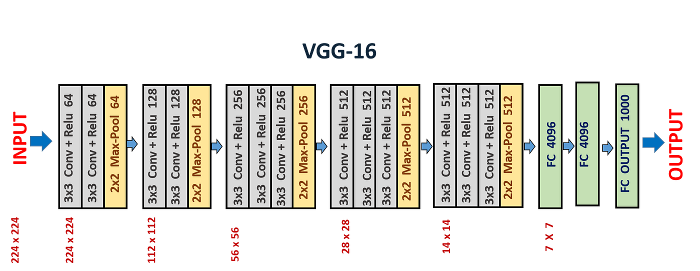

# Evaluating CIFAR-10 Generalization with ModernVGG-BN

An experimental computer-vision project exploring how a VGG-style convolutional
neural network performs on CIFAR-10 and how its accuracy changes on the
CIFAR-10.1 benchmark.

The project combines hands-on model training, practical training techniques,
evaluation on a separately collected test set, and a small Gradio image
classifier. Its research focus is **image classification and generalization
under dataset shift**.

**Trained model:** [ModernVGG-BN-CIFAR10 on Hugging Face](https://huggingface.co/Mudassir-08/ModernVGG-BN-CIFAR10)

The trained checkpoint is hosted separately from this GitHub project because
model weight files are large. Visit the Hugging Face repository to download the
checkpoint, review its model card, and use it for your own inference or further
experiments. The repository provides `best_model.pth`; the demo expects it at
`checkpoints/best_model.pth`.

> **Scope:** This is a research-oriented portfolio and learning project, not a
> claim of a new architecture or state-of-the-art result. The results below are
> transcribed from saved notebook outputs and have not been independently
> reproduced as part of this documentation.

## Research question

How does a VGG-style classifier trained on CIFAR-10 perform on the CIFAR-10.1
benchmark, and what does the difference in measured accuracy suggest about
generalization beyond the original test set?

The experiments also document an iterative training process: an initial
shorter run, followed by a longer run with a combination of commonly used
optimization and regularization techniques. The experiments are useful as
exploration, but they do not isolate the effect of each technique.

## Recorded results

| Experiment | Recorded result | Notes |
|---|---:|---|
| Initial run | 72.91% | Accuracy reported after 3 epochs on the CIFAR-10 test split. |
| Longer run | 98.92% train accuracy | Training accuracy after 22 epochs; not a held-out test result. |
| Longer run | 89.26% CIFAR-10 accuracy | The notebook calls this validation accuracy, but evaluates on the official CIFAR-10 test split and uses it to select checkpoints. |
| Longer run | 78.95% CIFAR-10.1 v6 accuracy | Reported on 2,000 CIFAR-10.1 v6 images. |

The CIFAR-10.1 result is **10.31 percentage points below** the reported CIFAR-10
result. This is an observed difference in these experiments, not proof of its
cause or a controlled estimate of a generalization effect. In particular,
using the CIFAR-10 test split for checkpoint selection means the reported
89.26% is not an untouched final test estimate.

The first two results are recorded in
[`notebook/VGG.ipynb`](notebook/VGG.ipynb) and
[`notebook/VGG_ready.ipynb`](notebook/VGG_ready.ipynb), respectively. The
CIFAR-10.1 evaluation is recorded in `VGG_ready.ipynb`. Results may vary with
randomness, software versions, hardware, and training environment.

The Hugging Face model card currently reports 99.95% training accuracy and
89.83% validation accuracy, alongside the same 78.95% CIFAR-10.1 result. These
training and CIFAR-10 figures differ from the saved notebook outputs above.
Treat the hosted card and notebook metrics as separate records until their run
and checkpoint provenance is reconciled; do not assume they describe identical
training runs.

## Method at a glance

- **Task:** 10-class image classification.
- **Datasets:** CIFAR-10 for training and evaluation; CIFAR-10.1 v6 for
  additional evaluation.
- **Model:** VGG-style convolutional neural network with batch normalization,
  max-pooling, and an adaptive-pooling classifier head, trained from scratch.
- **Input pipeline:** images resized to 224 × 224, normalized with CIFAR-10
  channel statistics, and augmented during training with random horizontal
  flips and crops.
- **Training techniques in the longer notebook run:** AdamW, cosine learning
  rate scheduling, automatic mixed precision (AMP), gradient clipping, and
  early stopping/checkpoint selection.
- **Application:** Gradio interface for trying the saved classifier on
  uploaded images.

These are established techniques used together in the recorded experiments.
The current results do not establish which individual technique caused an
improvement.

## Project structure

```text
.
├── app.py                     # Gradio image-classification demo
├── model.py                   # VGG-style model definition
├── train.py                   # Separate root-level training script
├── dataset.py                 # Separate root-level data-loader code
├── config.py                  # Separate root-level configuration
├── requirements.txt           # Application and experiment dependencies
├── runtime.txt                # Deployment runtime declaration
├── Architecture_img/
│   └── image.png              # Architecture illustration
├── notebook/
│   ├── VGG.ipynb              # Initial training experiment
│   └── VGG_ready.ipynb        # Longer experiment and CIFAR-10.1 evaluation
├── data/                      # Local CIFAR-10 files (ignored by Git)
├── checkpoints/               # Local model checkpoints (ignored by Git)
└── cifar-10.1/                # CIFAR-10.1 upstream repository (Git submodule)
```

Clone the GitHub project with its CIFAR-10.1 submodule:

```bash
git clone --recurse-submodules https://github.com/<your-username>/cifar10-generalization-study.git
```

Trained weights are not stored in this repository. Download the hosted
[`best_model.pth`](https://huggingface.co/Mudassir-08/ModernVGG-BN-CIFAR10/blob/main/best_model.pth)
from Hugging Face and put it in `checkpoints/best_model.pth` to run the demo.

### Architecture



## Getting started

### Install dependencies

Use Python 3.10 as declared in `runtime.txt`, then install the project
dependencies:

```bash
python -m venv .venv
```

Activate the virtual environment, then run:

```bash
python -m pip install --upgrade pip
python -m pip install -r requirements.txt
```

The training notebooks were developed in a notebook/Colab workflow and include
environment-specific paths and setup. Before replaying them, check the
notebook's path and data setup and run its cells in order. The CIFAR-10.1
evaluation cell expects the v6 arrays at
`cifar-10.1/datasets/cifar10.1_v6_data.npy` and
`cifar-10.1/datasets/cifar10.1_v6_labels.npy`.

### Run the demo

After downloading the checkpoint from
[Hugging Face](https://huggingface.co/Mudassir-08/ModernVGG-BN-CIFAR10), place
`best_model.pth` in `checkpoints/`. The Gradio app loads
`checkpoints/best_model.pth` relative to the project directory:

```bash
python app.py
```

The checkpoint is intentionally excluded from Git; obtain it from the linked
Hugging Face repository or use your own compatible checkpoint.

## Reproducibility and interpretation

- The notebooks are the record of the reported experiments. Their saved cell
  outputs contain the metrics summarized above.
- The CIFAR-10 test split is used for checkpoint selection in the longer
  notebook experiment. For a strict final evaluation, choose checkpoints on a
  separate validation split and reserve the test split for one final
  evaluation.
- CIFAR-10.1 provides a separately collected evaluation set, but the reported
  notebook result alone does not establish statistical significance or explain
  the performance difference.
- The root-level `train.py`, `dataset.py`, and `config.py` are not currently a
  verified, matching reproduction path: for example, the training script
  imports `Confi` while the config file defines `config`, and the data-loader
  code has a misspelled dataset class name and a different function interface.
  The root training script should not be presented as a verified way to
  reproduce the notebook results.
- No independent rerun, multiple-seed analysis, or controlled ablation study
  is claimed here.

## Research development ideas

These are possible next experiments, not results already established by this
project:

1. Make a stratified training/validation split and keep the CIFAR-10 test set
   out of checkpoint selection.
2. Compare a clearly defined baseline against one training technique at a
   time, holding the data split and training budget fixed.
3. Repeat each configuration with multiple random seeds and report mean and
   standard deviation.
4. Report per-class accuracy and a confusion matrix on both CIFAR-10 and
   CIFAR-10.1.
5. Record exact package versions, configuration, checkpoint identifier, and
   evaluation procedure for each run.
6. Compare predictions and errors across datasets to investigate possible
   sources of the observed generalization gap.

## Dataset and citation notes

CIFAR-10.1 is a benchmark introduced in *Do CIFAR-10 Classifiers Generalize to
CIFAR-10?* It contains new test images collected after the original CIFAR-10
dataset. This project uses its v6 data release. See
[`cifar-10.1/README.md`](cifar-10.1/README.md) for dataset details, attribution,
and data-use information. The upstream dataset materials have their own
licensing and usage terms; those terms are separate from this project's code.

```bibtex
@article{recht2018cifar10.1,
  author = {Benjamin Recht and Rebecca Roelofs and Ludwig Schmidt and Vaishaal Shankar},
  title = {Do CIFAR-10 Classifiers Generalize to CIFAR-10?},
  year = {2018},
  note = {\url{https://arxiv.org/abs/1806.00451}}
}
```

For project citation metadata, see [`CITATION.cff`](CITATION.cff). No license
for this project's own code is declared yet.
